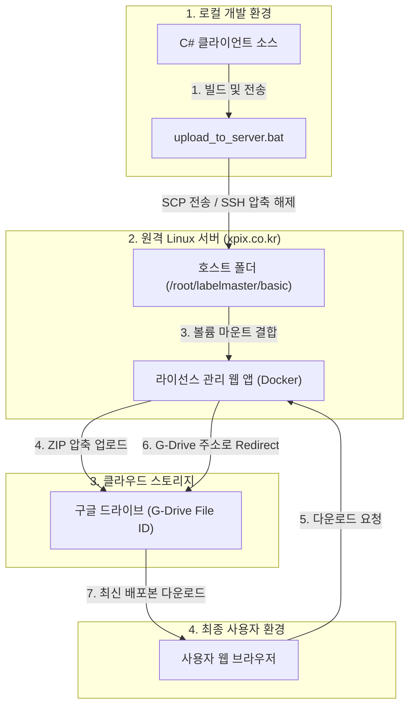
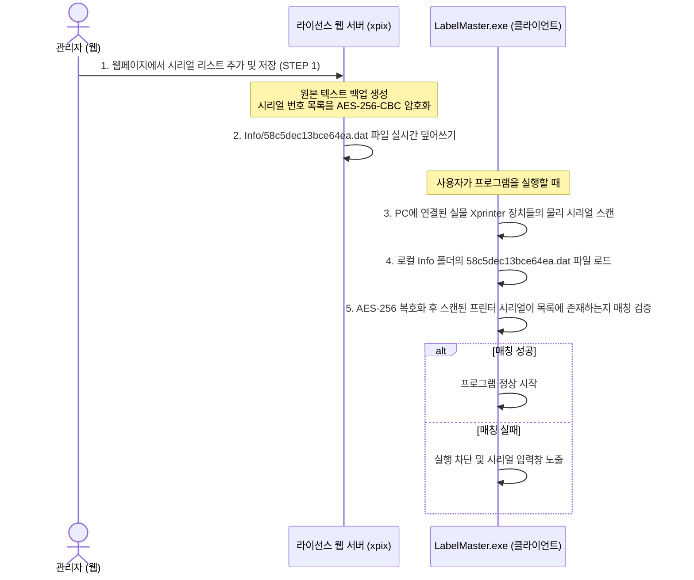

# LabelMaster Basic 배포 및 라이선스 관리 아키텍처 가이드

본 문서는 **LabelMaster Basic (C# 클라이언트)** 프로그램의 빌드 및 배포 과정, 그리고 **labelmaster_serial (라이선스 관리 웹 사이트)**을 통한 시리얼 번호 인증 관리 아키텍처와 핵심 동작 로직을 정리한 가이드입니다.

---

## 1. 시스템 컴포넌트 구조 (System Overview)

LabelMaster 시스템은 로컬 컴퓨터, 리눅스 웹 서버, 그리고 구글 드라이브 배포 스토리지 간의 유기적인 연동으로 동작합니다.

---

## 2. 시리얼 번호 라이선스 관리 로직

라벨 프린터 프로그램의 무단 복제를 방지하고 허가된 Xprinter 기기에서만 작동하도록 제어하는 인증 메커니즘입니다.

### 암호화 및 파일 구조
* **암호화 알고리즘**: AES-256-CBC (PKCS7 패딩)
* **비밀키 (Key)**: `XQuick_License_Secret_Key_2026!#` (32바이트)
* **초기화 벡터 (IV)**: `XQuick_InitVecto` (16바이트)
* **인증 파일명**: `58c5dec13bce64ea.dat` (Base64 인코딩 스트링 형태로 저장됨)

---

## 3. 프로그램 빌드 및 배포 자동화 로직

개발자가 클라이언트 소스코드를 수정하고 서버에 배포 패키지를 준비하기 위한 자동화 배치 파일 명세입니다.

### ① 빌드 및 업로드 배포 (`build_and_upload_to_server.bat`)
* **역할**: 로컬 소스 빌드(Release)부터 웹 서버 전송까지 원클릭으로 수행합니다.
* **상세 스텝**:
  1. 현재 실행 중인 `LabelMaster.exe` 프로세스를 강제 종료합니다.
  2. `update_version.py`를 호출하여 프로젝트 버전 정보를 자동으로 1 증가시킵니다.
  3. `MSBuild.exe`를 자동 탐색하여 솔루션(`BarcodePrint.sln`)을 Release 모드로 컴파일합니다.
  4. 컴파일 결과물(`LabelMaster.exe`, `printer.sdk.dll`, `Info` 폴더)을 배포용 폴더(`bin\LabelMaster_Basic`)에 덮어씁니다. (이때 배포본 폴더 내 불필요한 임시 로그 파일인 `PrinterSerialMatch.log`와 `serials.dat`를 자동 제외/삭제 처리합니다.)
  5. 배포용 폴더를 `release_basic.tar`로 압축하여 `scp` 명령어로 서버(`xpix.co.kr`)의 `/root/` 경로로 전송합니다.
  6. `ssh` 명령어로 원격 서버의 `/root/labelmaster/basic` 폴더를 최신 파일로 교체합니다.

### ② 단순 전송 배포 (`upload_to_server.bat`)
* **역할**: 로컬 빌드를 건너뛰고, 이미 완성되어 있는 `bin\LabelMaster_Basic` 배포 폴더의 내용만 서버로 전송 및 배포합니다.
* **장점**: 빌드 설정이 없거나, 임의의 수동 작업본을 즉시 서버에 반영할 때 안전하고 빠르게 쓰입니다.

---

## 4. 구글 드라이브 연동 및 갱신

웹 서버의 도커(Docker) 컨테이너가 배포 파일을 최종 사용자용 구글 드라이브 스토리지로 업로드 및 동기화하는 메커니즘입니다.

### ① 구글 드라이브 덮어쓰기 동기화 (`SyncAndZipToGDrive`)
* **실행 시점**: 로컬 배포본 업로드 후, 혹은 시리얼 번호가 새롭게 저장되어 배포본 내 `58c5dec13bce64ea.dat` 라이선스 파일이 갱신되었을 때 관리자 페이지에서 클릭합니다.
* **상세 스텝**:
  1. 서버의 배포 디렉토리인 `/app/ReleaseFolder` (호스트의 `/root/labelmaster/basic` 경로가 마운트됨) 내 `LabelMaster.exe`에서 버전 정보를 읽습니다.
  2. 전체 배포 파일을 `LabelMaster_Basic_v{버전}.zip` 포장 파일로 임시 압축합니다.
  3. **Google Service Account** 인증 키(`service_account.json`)를 사용해 구글 드라이브의 단일 고유 파일 ID(`1Ixw2dg4CTH9KfAfWuX4dwp7u5XLTSqbv`)에 덮어쓰기(Update) 전송합니다.
  4. 전송 완료 후 임시 압축 파일을 청소합니다.

### ② 사용자 배포 링크 리다이렉트
* 사용자가 프로그램 다운로드 주소(예: `xpix.co.kr/labelmaster/basic`)로 진입할 경우, 웹 서버는 구글 드라이브의 다이렉트 다운로드 경로로 **302 Redirect** 시켜 최종 최신 버전 압축파일을 안전하고 빠른 속도로 다운로드할 수 있게 보장합니다.

---

## 5. 관리 및 배포 시나리오별 가이드

상황에 따라 필요한 조작을 나열한 빠른 메뉴얼입니다.

| 시나리오 | 수행할 작업 | 비고 |
| :--- | :--- | :--- |
| **단순 시리얼 추가 / 삭제** | ① 관리자 페이지에서 시리얼 리스트 수정 및 **[저장]** ② **[구글 드라이브 동기화 및 압축 업로드]** 클릭 | 빌드 및 서버 명령어 실행 필요 없음 |
| **프로그램 기능(C# 소스) 수정** | ① 로컬에서 **`build_and_upload_to_server.bat`** 실행 ② 관리자 페이지에서 **[구글 드라이브 동기화 및 압축 업로드]** 클릭 | 최신 파일 업로드 후 드라이브 동기화 진행 |
| **관리자 페이지 화면 / 기능 수정** | ① `labelmaster_serial` 내 웹 백엔드 및 뷰 수정 ② **`deploy_docker.bat`**를 실행해 도커 재배포 | 웹서버 애플리케이션의 재부팅 과정 필요 |
